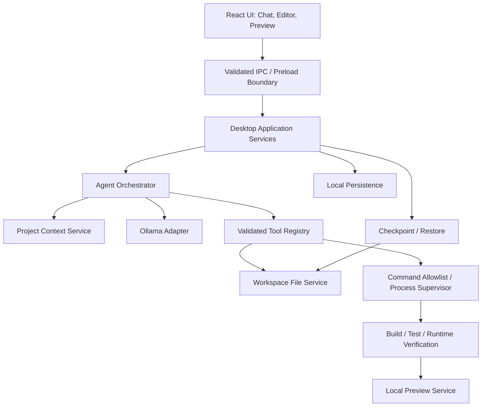

# System Architecture

## Architecture goals
- Modular desktop application.
- Local model inference via Ollama adapter.
- Strict separation between UI, agent orchestration and execution tools.
- Workspace boundary enforcement.
- No required cloud service.
- Testable interfaces and replaceable model/runtime adapters.

## Proposed stack (validate during implementation)
- Desktop shell: Electron.
- UI: React + TypeScript.
- Bundling/build: Vite (appropriate Electron configuration).
- Editor: Monaco Editor or a compatible editor component.
- Styling: Tailwind CSS (or a consistent accessible styling system).
- Local model runtime: Ollama HTTP API on localhost.
- Agent orchestration: TypeScript service layer.
- Storage: SQLite (e.g. a maintained local SQLite integration) or another documented local persistence approach.
- Project preview: local development server + preview webview/browser panel.
- Project commands: controlled process runner, not unrestricted agent shell.
- Tests: Vitest, UI tests where practical, integration tests and manual offline test.

## Logical components
1. Desktop UI shell
2. Workspace/project service
3. Context collector/indexer
4. Model provider adapter (Ollama)
5. Agent orchestrator (planner, executor, context budget, state)
6. Tool registry and validators
7. File tools
8. Project-type detector
9. Command allowlist/process supervisor
10. Preview service
11. Verification/test runner
12. Repair controller with retry cap
13. Checkpoint/restore service
14. Local database/settings
15. Logging/error reporting (local and redacted)

## Request lifecycle
User input -> request validation -> project/context retrieval -> plan -> approval -> tool execution -> checkpoint -> file changes -> supported execution -> verification -> bounded repair if needed -> final status/report.

## Suggested directory structure
```text
nova-ide/
  apps/
    desktop/
      src/
        main/
        preload/
        renderer/
  packages/
    agent/
    model-adapters/
    project-context/
    workspace-tools/
    execution/
    verification/
    shared/
  docs/
  tests/
  scripts/
```
The implementation may adapt this structure but should preserve separation of responsibilities.

## Mermaid architecture


## IPC and trust boundaries
- Electron renderer must not receive unrestricted Node access.
- Use context-isolated preload and validated IPC.
- Main-process operations must validate arguments, paths and permissions.
- Never expose arbitrary shell execution through generic IPC.
- Restrict preview navigation and prevent external navigation by default.
